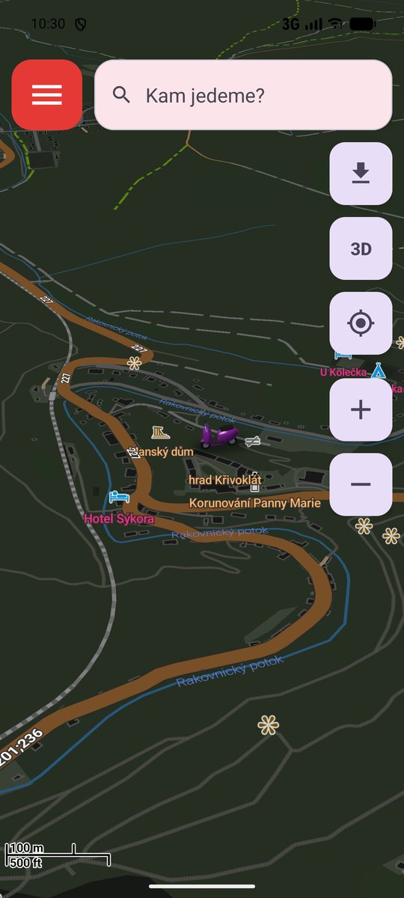
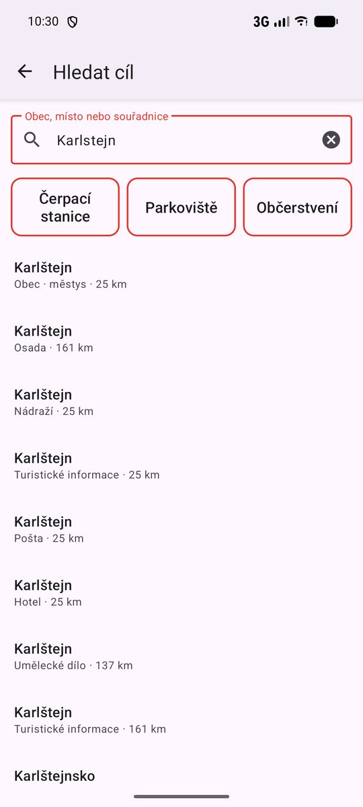
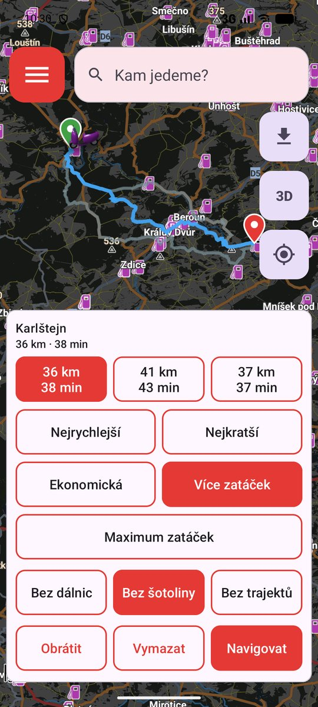
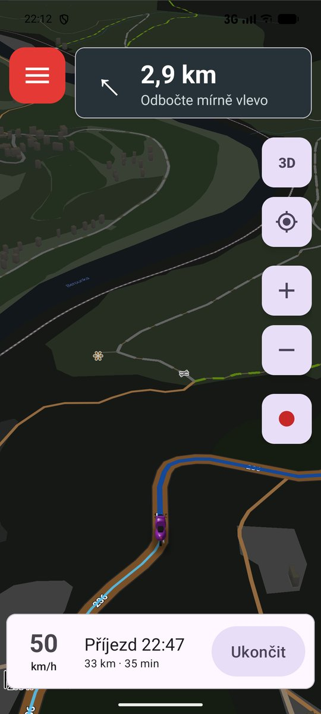
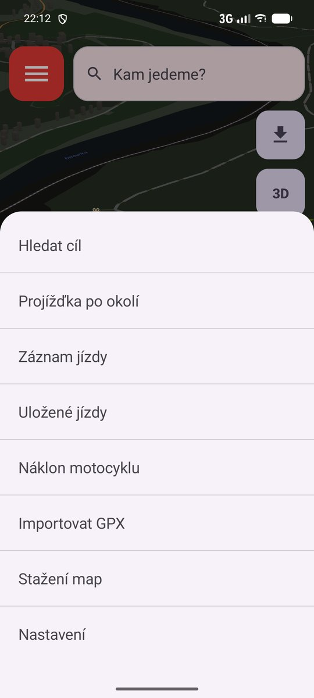
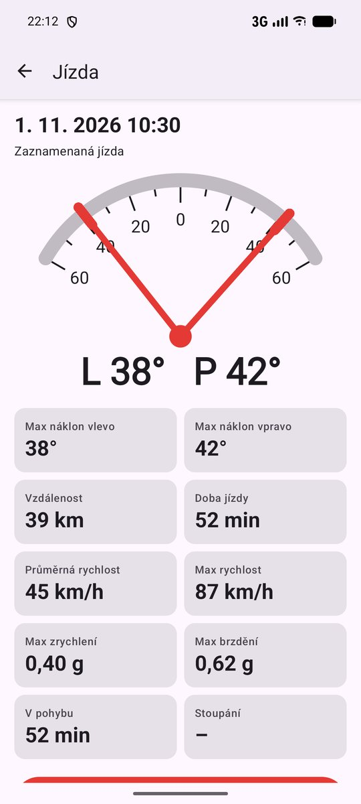
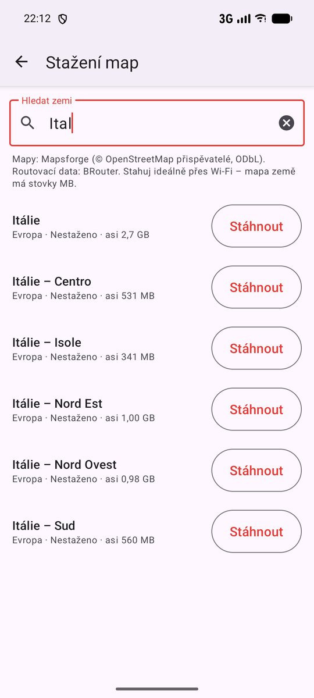
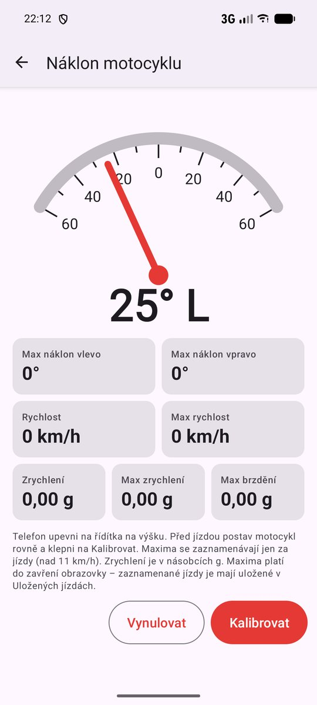
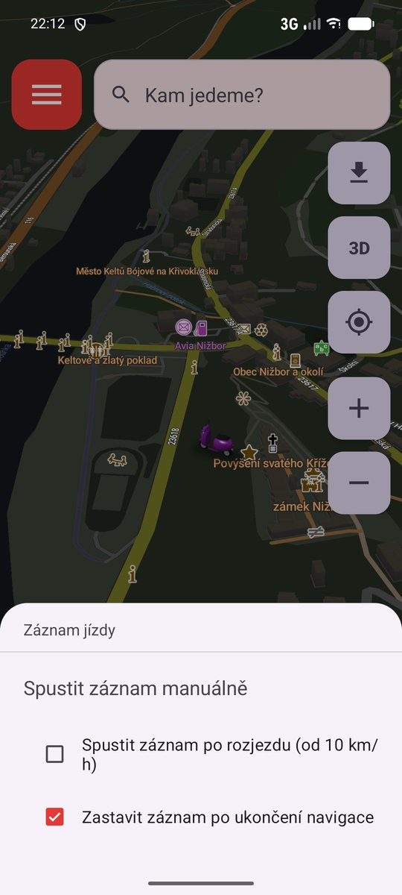
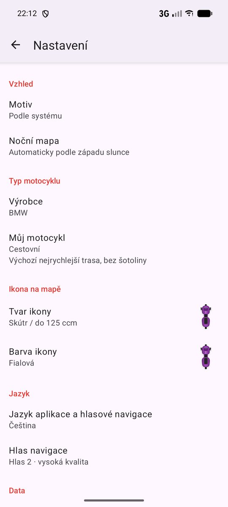

# Serpentina-motonavigation

Offline motonavigace pro Android. Pod ikonou v telefonu se aplikace jmenuje **Serpentina**.

## Stažení do telefonu

**[Stáhnout Serpentina-latest.apk](https://github.com/zitluk/Serpentina-motonavigation/releases/latest/download/Serpentina-latest.apk)** – vždy nejnovější verze, Android 8.0 až Android 17.

Odkaz otevři v telefonu, stažený soubor spusť a povol instalaci z prohlížeče (Android se zeptá sám). Novější verze se instaluje přes starší, mapy i nastavení zůstanou. Starší verze najdeš v [Releases](https://github.com/zitluk/Serpentina-motonavigation/releases) pod číslem verze.

## Jak to vypadá

<table>
  <tr>
    <td align="center"> Mapa ve 3D</td>
    <td align="center"> Hledání cíle</td>
    <td align="center"> Výběr trasy</td>
    <td align="center"> Navigace</td>
    <td align="center"> Menu pro rukavice</td>
  </tr>
  <tr>
    <td align="center"> Detail jízdy (ukázka)</td>
    <td align="center"> Stažení map</td>
    <td align="center"> Náklon motocyklu</td>
    <td align="center"> Záznam jízdy</td>
    <td align="center"> Nastavení</td>
  </tr>
</table>

## Co umí

- **Offline mapy** ve 3D (nakloněná, po směru jízdy), 2D po směru jízdy nebo se severem nahoře; bez rušivých vrstev (parkoviště, obchody, MHD…), s 3D budovami. Mapa drží tvoji polohu uprostřed i bez navigace; když ji posuneš prstem, za jízdy se k tobě po chvíli vrátí sama
- **Noční mapa** v tmavých barvách – automaticky po západu slunce, podle vzhledu aplikace, vždy nebo nikdy
- **Trasy** bez internetu: Nejrychlejší / Nejkratší / Ekonomická (plynule po hlavních silnicích a dálnicích, bez zbytečných průjezdů obcemi) / Více zatáček / Maximum zatáček, volby bez dálnic / bez šotoliny / bez trajektů, ke každému cíli až 3 varianty s délkou a časem
- **Navigace** s hlasovými pokyny česky i anglicky, okamžitým přepočtem, když úmyslně změníš cestu (nová trasa tě nevrací zpátky), a doporučením jízdního pruhu před manévrem na vícepruhové silnici; během navigace rychlost podle GPS, zoom podle rychlosti, prohlížení celé trasy gestem (zpět k motorce tlačítkem polohy) a upozornění na radary, které jdou v bodech zájmu vypnout (hlasem i štítkem s povolenou rychlostí, červeně při překročení)
- **Vyhledávání cíle** – obce, místa, body zájmu i souřadnice, s diakritikou i bez ní; stejnojmenné obce rozlišené okresem. Rychlé volby **Čerpací stanice**, **Parkoviště** a **Občerstvení** najdou nejbližší místa. Dokud nic nepíšeš, ukazuje **nedávné cíle** navigace – podržením jeden odebereš, tlačítkem Smazat historii všechny
- **Projížďka po okolí** – okruh zvolené délky (20–300 km) z aktuální polohy, „Jiný okruh“ vylosuje jiný směr
- **Poloha motorky** – po ukončení navigace si aplikace pamatuje, kde motorka stojí; při dalším spuštění dál než 20 m od ní nabídne navigaci k motorce (na mapě se pak ukazuje chodec)
- **Záznam jízdy** do GPX (i se zhasnutou obrazovkou) se statistikami: vzdálenost, čas, průměrná a max. rychlost, stoupání. Když se rozjedeš bez navigace, aplikace se velkou nabídkou zeptá, jestli jízdu zaznamenat (nebo zaznamenávat vždy po rozjezdu)
- **Náklon motocyklu** – ukazatel náklonu, maximální náklon vlevo/vpravo, rychlost, zrychlení a brzdění v g (maxima platí do zavření obrazovky); záznam jízdy si je ukládá ke každé jízdě; při každé navigaci se měří automaticky a po jejím ukončení aplikace nabídne souhrn jízdy (vzdálenost, čas, průměrná a max. rychlost, max. náklon, zrychlení a brzdění)
- **GPX** – import, zobrazení, navigace po stopě, sdílení
- **Ovládání v rukavicích** – velká tlačítka v celé aplikaci, menu a volby přes celou šířku displeje
- **Ikona polohy** – šipka nebo silueta motocyklu (sportovní, cestovní, naked, enduro, chopper, skútr) v 8 barvách, natočená po směru jízdy
- **Výrobce motocyklu** změní ikonu aplikace i úvodní logo přes celou šířku displeje; typ cest (zatáčky po asfaltu, dlouhé přesuny, asfalt i šotolina, klidné vyjížďky, okolí bez dálnic) přednastaví typ trasy, šotolinu, dálnice a odhad času
- **Nastavení** – světlý / tmavý vzhled, jazyk aplikace i hlasové navigace (čeština / angličtina / podle systému), výběr hlasu navigace s ukázkou (nebo bez hlasu), vypnutí mobilních dat (stahování, kontrola aktualizací a zpětná vazba jen přes Wi-Fi), výběr bodů zájmu na mapě (pumpy, radary, vyhlídky, průsmyky, ubytování, parkoviště, restaurace…; zapnuté nahoře seznamu)
- **Zpětná vazba** vývojáři přímo z aplikace a možnost drobné podpory přes QR Platbu
- **Sdílení aplikace** – QR kód s odkazem ke stažení v Nastavení, nebo odeslání odkazu zprávou

## Ovládání

- Lišta **Kam jedeme?** (nebo menu ☰ → Hledat cíl) → vyber cíl nebo ťukni na rychlou volbu → trasa z aktuální polohy
- Dlouhý stisk do mapy → Start / Průjezdní bod / Cíl (bez startu se vyjíždí z aktuální polohy)
- Panel trasy dole: délka, čas, varianty, typ trasy, vyhýbání, **Navigovat**
- Tlačítko **3D / 2D / N** vpravo nahoře přepíná zobrazení mapy, tlačítko polohy vycentruje mapu na tvoji polohu. Dokud GPS nezná přesnou polohu, ukazuje se „Prosím počkejte na přesnou polohu“
- Menu ☰ → **Projížďka po okolí** → zvol délku → Vytvořit; Obrátit pojede okruh opačně
- Menu ☰ → **Záznam jízdy** → **Spustit záznam manuálně** (červený štítek REC na mapě, ťuknutím záznam zastavíš) a zaškrtávací volby **Spustit záznam po rozjezdu (od 10 km/h)**, **Zeptat se po zahájení jízdy** a **Zastavit záznam po ukončení navigace**
- Během navigace mapu posuneš nebo oddálíš gestem a prohlédneš si celou trasu; tlačítko polohy (nebo 15 s bez dotyku) vrátí mapu za motorku. Tlačítka + / − přibližují až na detail ulic
- Menu ☰ → **Uložené jízdy** – seznam jízd podle data a času; ťuknutím detail jízdy s náklonem, vzdáleností, časy, rychlostmi, zrychlením a stoupáním → Sdílet jako obrázek / Zobrazit na mapě / Navigovat po trase / Sdílet GPX / Smazat
- Navigace po GPX naplánuje trasu po silnicích přes body vybrané ze stopy, takže má pokyny i přepočet
- Během navigace: další manévr nahoře, rychlost, příjezd a zbývající km dole, **Ukončit** (nebo tlačítko Zpět)
- Mapy se stahují v aplikaci (**Stažení map**) po zemích z celého světa, velké země i po částech (např. Itálie – Isole = Sardinie a Sicílie): mapa, body zájmu i data pro trasy. Zemi najdeš polem **Hledat zemi** (česky i anglicky, s diakritikou i bez), u každé je vidět přibližná velikost. U stažené mapy se ukazuje datum dat a při novější verzi tlačítko Aktualizovat

## Známá omezení

- Čas se odhaduje podle třídy silnice a rychlostních limitů, ne podle skutečného provozu.
- Zatáčkové trasy se řídí třídami silnic, ne skutečnou geometrií zatáček.
- Pokyny jsou bez názvů ulic.
- Vyhledávání nezná adresy (ulice, čísla popisná) – jen obce, místa a body zájmu.
- Navigace běží jen s aplikací v popředí (obrazovka zůstává zapnutá).
- Délka okruhu se trefí zhruba na ±12 %. Delší okruh může zasáhnout mimo stažený region – pak je potřeba stáhnout i sousední.
- Navigace po GPX nekopíruje stopu bod po bodu – mezi vybranými body volí cestu podle zvoleného typu trasy.
- Trasa k zaparkované motorce se plánuje jako pro motorku (jednosměrky, bez pěších zón).
- Zatím bez stínování reliéfu a oblíbených míst.
- Náklon předpokládá telefon na řídítkách na výšku, vyrovnaný kalibrací.
- Radary pocházejí z OpenStreetMap – některé mohou chybět, mobilní měření v datech není.

## Data a licence

Mapy: Mapsforge, data © přispěvatelé [OpenStreetMap](https://www.openstreetmap.org/copyright) (ODbL). Trasy: [BRouter](https://github.com/abrensch/brouter) (MIT). Loga výrobců jsou ochranné známky svých vlastníků a slouží jen k označení motocyklu; zdroje a licence jsou v [LOGOS.md](LOGOS.md).

## Autoři

© 2026 **Tutenservis.cz** – zadání, testování a vydávání. Aplikaci programuje AI **Claude** (Anthropic).
